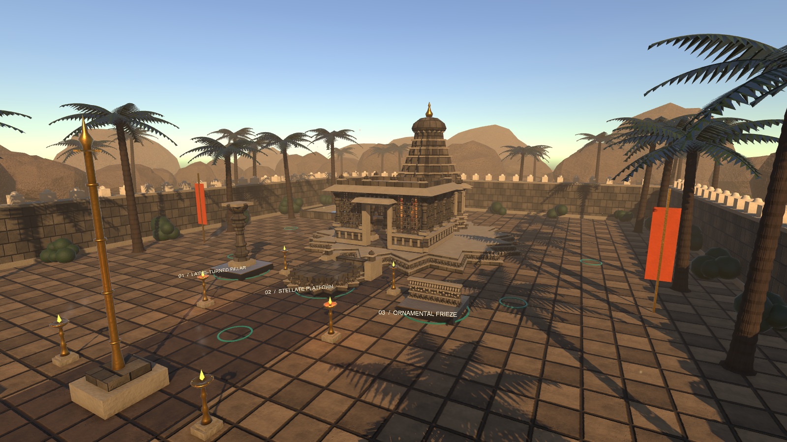
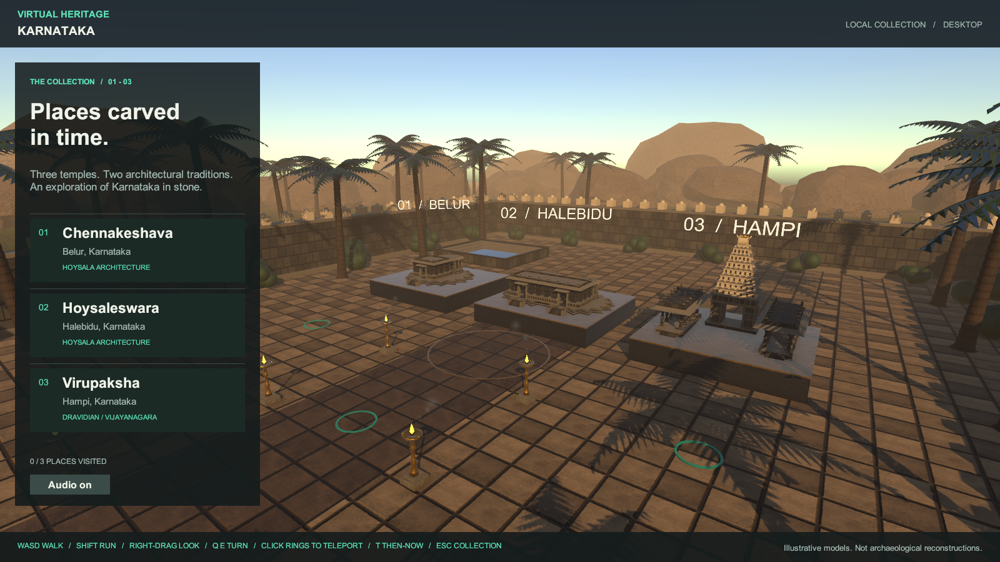
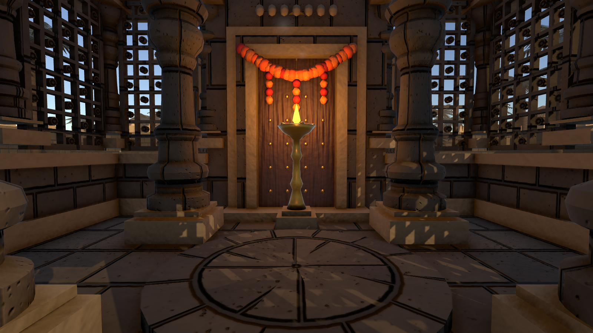
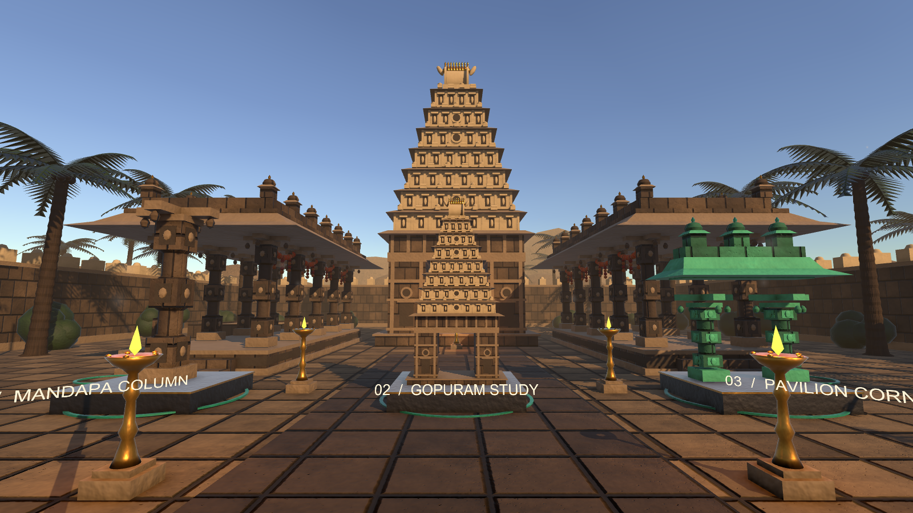
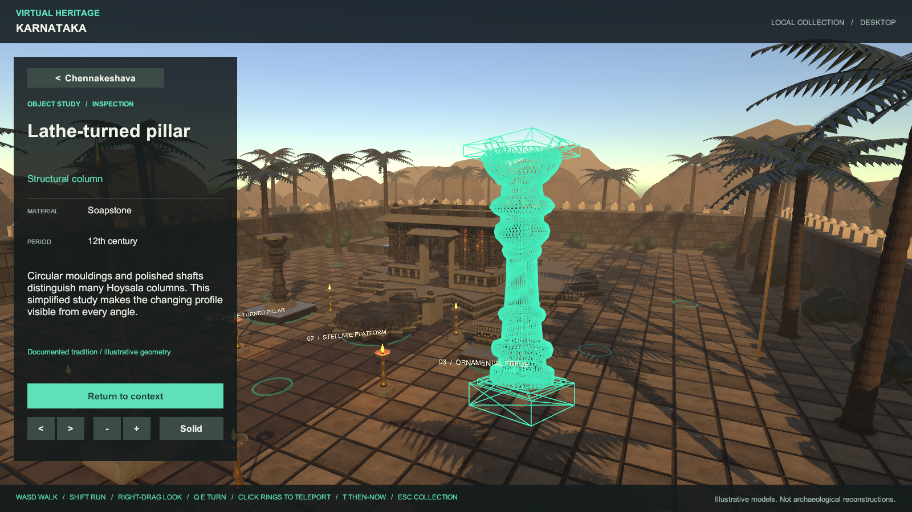

<div align="center">

# 🛕 Virtual Heritage Karnataka

### Walk through three of Karnataka's great temple traditions: in VR, on desktop, or right in your browser.

[](https://virtual-heritage-karnataka-cgvr.vercel.app)




*Chennakeshava (Belur) in the **Then** state: stellate platform, jali-screened hall and an illustrative tower.*

</div>

---

## ✨ Highlights

- **Three temple studies** in one walled courtyard world:
  - **Chennakeshava, Belur** (Hoysala): star-shaped platform, a closed hall with pierced stone screens, a turned-pillar interior.
  - **Hoysaleswara, Halebidu** (Hoysala): twin shrines on a shared platform, wrapped in elephant, scroll and lotus friezes.
  - **Virupaksha, Hampi** (Vijayanagara): a seven-tier gopuram with niches, kudu arches and a barrel crown, flanked by pillared pavilions.
- **Walk it for real:** WASD on desktop, thumbstick or teleport in VR. You step up onto platforms and stairs, and walls and pillars stop you.
- **Then / Now:** weathered present-day finishes against an illustrative restoration, including towers that no longer survive.
- **Inspect any exhibit:** pull out a copy, rotate it, scale it, and switch to wireframe to see its mesh.
- **Historical timeline and metadata** for nine architectural elements, each with a confidence label.
- **Fully procedural:** every mesh, stone texture, normal map and sound is generated by code. There are no downloaded models, textures or audio.

## 📸 Gallery

<table>
<tr>
<td width="50%"><br><sub><b>The collection:</b> three miniatures; click one to enter.</sub></td>
<td width="50%"><br><sub><b>Inside the hall:</b> jali screens, turned pillars, lamp light.</sub></td>
</tr>
<tr>
<td width="50%"><br><sub><b>Hampi:</b> gopuram, pavilions and composite granite pillars.</sub></td>
<td width="50%"><br><sub><b>Inspection:</b> a lathe-turned pillar in wireframe.</sub></td>
</tr>
</table>

## 🚀 Try it

| Platform | How | Notes |
| --- | --- | --- |
| 🌐 **Browser** | Open **[virtual-heritage-karnataka-cgvr.vercel.app](https://virtual-heritage-karnataka-cgvr.vercel.app)** | Desktop Chrome or Edge. About 50 MB on first load, then cached. Lighter effects, no VR. |
| 🖥️ **Windows desktop** | Build, then double-click `Launch Desktop.cmd` | Full quality, no headset needed. |
| 🥽 **PC VR** | Start your OpenXR runtime, connect the headset, then run `Launch VR.cmd` | Quest Link / Air Link, Index, Vive, Windows MR. |
| 🛠️ **Unity editor** | Open the folder in Unity Hub, open `Assets/Heritage/Scenes/Heritage.unity`, press Play | `Heritage > Configure Project` recreates the scene and settings. |

## 🎮 Controls

| Action | Desktop | VR |
| --- | --- | --- |
| Walk | **WASD** / ↑↓ (Shift runs) | Left stick (smooth) or point at a jade ring + trigger to teleport |
| Look / turn | Hold **right mouse** and drag · ←→ or **Q/E** | Head · right stick for 30° snap turn |
| Enter a temple / select an exhibit | Click the model or its panel entry | Point + trigger |
| Inspect · rotate · scale | **I** · Q/E or arrows · mouse wheel | Panel buttons · left stick |
| Wireframe | **F** | Mesh/Solid button |
| Then / Now | **T** | Panel buttons |
| Timeline | Drag the slider | Aim + drag with trigger |
| Back / collection | **Esc** / **H** | Collection button or left menu button |

## 🧱 Tech stack

| Layer | Technology |
| --- | --- |
| Engine | **Unity 6** (6000.6.1f1), C# (Mono backend for Windows, IL2CPP → WebAssembly for the web) |
| Rendering | **Universal Render Pipeline 17.6**: HDR, ACES tonemapping, bloom, colour grading, 4× MSAA, soft 4-cascade 4K shadows, SSAO |
| XR | **OpenXR 1.18**, **XR Interaction Toolkit 3.6** (ray interactors, teleportation provider, XR UI input module), XR Core Utils, XR Management |
| Input | **Unity Input System 1.20** (keyboard, mouse and XR controller bindings created in code) |
| UI | uGUI: screen-space on desktop, world-space panel in VR |
| Content | A JSON catalog (`temples.json`) of temples, elements, timelines and confidence labels |
| Procedural art | Custom `MeshBuilder` (boxes, lathes, stellate prisms, ellipsoids, icospheres) and tileable FBM noise for albedo and normal maps |
| Audio | Synthesized at runtime: wind ambience, a spatial temple bell, UI chimes |
| Web | Unity **WebGL 2** build, deployed as static files on **Vercel** |
| Testing | Built-in **smoke test** (`--heritage-smoke`) that tours every temple and exhibit and fails on errors or magenta (missing-shader) pixels |

## 🗂️ Project layout

```
Assets/Heritage/
├── Editor/
│   ├── HeritageProject.cs     # One-click project setup + Windows and WebGL builds
│   └── HeritageCapture.cs     # Editor screenshot capture
├── Resources/
│   ├── temples.json           # Temple, element, timeline and confidence data
│   └── Shaders/               # Anchor materials that keep runtime shaders in builds
├── Runtime/
│   ├── HeritageApp.cs         # Gallery, location building, Then/Now, inspection
│   ├── HeritageGeometry.cs    # Procedural textures + temple architecture
│   ├── MeshBuilder.cs         # Low-level mesh construction
│   ├── HeritageAtmosphere.cs  # Landscape, palms, boulders, lamps, lighting, post-processing
│   ├── HeritageRig.cs         # Desktop and VR locomotion, collision, comfort veil
│   ├── HeritageUI.cs          # Desktop and VR interface
│   ├── HeritageTarget.cs      # Selectable / highlightable objects
│   ├── HeritageAudio.cs       # Synthesized sound
│   ├── HeritageSmoke.cs       # Automated journey test
│   └── HeritageShots.cs       # Scripted screenshot tour
├── Scenes/Heritage.unity      # Near-empty scene: everything is built at runtime
└── Settings/                  # URP (desktop + web) and XR settings
Tools/Build.ps1                # Command-line build (+ -Smoke)
```

## 🔨 Build from source

**Requirements:** Unity **6000.6.1f1** (changeset `7efac9f6c10e`) with *Windows Build Support*, plus *Web Build Support* for the browser version.

```powershell
# Windows desktop / VR build (Builds/Windows)
.\Tools\Build.ps1
.\Tools\Build.ps1 -Smoke     # also runs the automated journey test

# Browser build (Builds/WebGL), or use the Unity menu: Heritage > Build WebGL (browser)
& "C:\Program Files\Unity\Hub\Editor\6000.6.1f1\Editor\Unity.exe" -batchmode -quit -projectPath . -executeMethod VirtualHeritage.Editor.HeritageProject.BuildWebGL

# Deploy the browser build
cd Builds\WebGL
vercel deploy --prod --name virtual-heritage-karnataka-cgvr
```

The smoke test checks all three temples, all nine inspections, the timelines, Then/Now, teleports, audio and UI modes, and writes `Artifacts/smoke-results.json` plus screenshots (currently **98 / 98 passing**). It can't certify headset optics, comfort or frame rate on your hardware, so do a quick pass on a real headset.

## 🧯 Troubleshooting

| Symptom | Fix |
| --- | --- |
| Pink / magenta patches, or no WASD | You're running an old build. Rebuild; the launchers run whatever is in `Builds/Windows`. |
| Build fails: `Failed to write file … unity_builtin_extra` | Built-in shaders were added to *Graphics → Always Included Shaders*. Run `Heritage > Configure Project`, which removes them, and rebuild. |
| `Unity editor not found` | Install 6000.6.1f1 from Unity Hub (changeset `7efac9f6c10e`). |
| VR doesn't start | Connect the headset and start its OpenXR runtime **before** launching. |

## 📜 Historical scope

All geometry is newly generated, deliberately simplified, and **not a measured reconstruction or photogrammetric model**. Decorative motifs (elephant processions, scrolls, lotus bands, jali screens) are abstract placeholders. **No sacred sculpture is depicted**, and sanctum doors are shown closed. The original towers above the Belur and Halebidu sanctums no longer survive, so *Now* shows them without superstructures. *Then* adds an **illustrative** tower, refreshed finishes and festive textiles; it is not evidence of a specific historical appearance or date.

References (stored locally; the app does not fetch them):
- [UNESCO: Sacred Ensembles of the Hoysalas](https://whc.unesco.org/en/list/1670/)
- [UNESCO: Group of Monuments at Hampi](https://whc.unesco.org/en/list/241/)

## 🙏 Asset notes

Geometry, textures and sound are generated by this project's source code. No external temple models, downloaded audio, paid assets or cloud credentials are used. The app has no backend, accounts or analytics. Unity packages and the built-in Unity font keep their own licences.

<div align="center"><sub>Made with Unity · Karnataka's living heritage in stone</sub></div>
